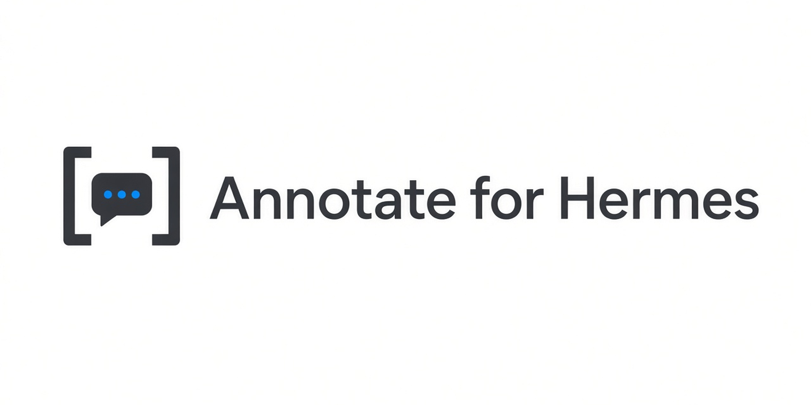

# Annotate for Hermes



Give feedback on several parts of an assistant response in one message.

Select a passage, choose **Add to chat**, and add a comment. Repeat across earlier responses. Your selections collect in one **N annotations** attachment inside the main composer. Open the attachment to review, edit, or remove individual comments, then send it with your ordinary reply.

## Availability

**Development preview. This is not yet a one-click plugin for unmodified Hermes.** The attachment UI requires the proposed `host.composer.annotations` API, including `captureSelection()`. The native extension is included under `integration/` for developers and upstream review.

Installing the plugin alone in stock Hermes will show a compatibility notice. It will not modify Hermes to make itself work. It is not currently in the curated plugin catalog. Ordinary in-app install and update remain blocked until the annotations API ships in a stable Hermes release and catalog review completes. The manifest `requires_hermes` value is a development baseline only, not a compatibility claim: no released Hermes version, including the latest stable v0.23.0, ships `host.composer.annotations`. A real compatible floor can only be set after the API is released.

The native integration is proposed in [Hermes PR #146959](https://github.com/NousResearch/hermes-agent/pull/146959). That PR is still open and unmerged. [Catalog PR #146960](https://github.com/NousResearch/hermes-agent/pull/146960) is a draft pending that API release; it is not a ready catalog pin.

The goal is a normal in-app install after the native API is available and the plugin passes catalog review. Do not describe this preview as available through Hermes' catalog.

## Interaction

- Selection toolbar action: **Add to chat**.
- Editor primary action: **Add to reply** for a new annotation; **Save** when editing an existing one. A duplicate selection shows **Already added**.
- The editor labels the quote as **Selected text** (read-only) and the field as **Comment**.
- Enter stages a comment; Shift+Enter inserts a line break. Staging never sends a message.
- Escape or the close control on an unfinished comment asks **Resume** or **Discard**.
- Multiple selections and comments stay paired in one attachment.
- The ordinary reply keeps its contents and whitespace.
- Selected text and comments retain their full contents, including code indentation. Host limits (100 items, 64k per field, 512k encoded) surface recovery copy; drafts are not truncated on failure.
- Comments remain editable when a draft write fails. Unfinished comments stay in memory for their original connection, profile, and chat while the plugin remains loaded.
- Owner guards: every read and write is scoped to the focused chat's owner (connection, profile, chat). When the host exposes `focusedSessionOwner`, an unresolved owner fails closed and nothing is staged. Older hosts fall back to `focusedSessionProfile` and the connection ID. If the focused chat changes while a draft read is in flight, the write is abandoned and the comment stays editable; an unfinished comment is restored only when its original owner is focused again.
- A compact preview uses the current Hermes theme, short motion, and the operating system's reduced-motion preference.
- Normal copy commands, model selection, tools, and other plugins are not changed.

## Developer setup

The tested Hermes source base is `5057eaa3a4d0cbef0e30078418a5115faa62889e`. Use a separate checkout and a disposable Hermes home. Do not apply the extension over unrelated work.

1. Build a compatible Hermes desktop with the native extension in `integration/`.
2. Install this repository using Hermes' plugin installer, pinning an exact commit:

   ```sh
   hermes plugins install https://github.com/LarryLemonBot/annotate-for-hermes --ref FULL_COMMIT_SHA --enable
   ```

3. In **Capabilities → Plugins**, open **Annotate for Hermes** and enable its **Desktop** switch. The CLI `--enable` flag controls the separate agent component.
4. Use **Reload desktop plugins** in the command palette if the app was already open.
5. Select assistant text and choose **Add to chat**. An existing draft should stay intact.

Development dependencies are confined to `tests/`; installing the plugin does not require npm.

The plugin is plain JavaScript with no runtime dependencies, Python hooks, model requests, external network calls, or background processes. All composer reads and writes use the public SDK. Selection eligibility belongs to the native API so the plugin does not depend on private transcript markup.

## Verification

```sh
npm --prefix tests ci
npm --prefix tests test
hermes plugins validate .
```

Current automated coverage in this repository:

- **Unit (vitest):** 33 tests in two files covering selection popup polish, Escape Resume/Discard, duplicate handling, highlight cleanup, draft preservation, host limit recovery copy, and the owner guards (owner switches, null owner, profile fallback, owner changes during asynchronous draft reads).
- **`hermes plugins validate`:** manifest, security scan, desktop SDK surface, and no core override on the plugin tip.
- **`tests/native.mjs`:** isolated development renderer through Hermes' performance-test connection. Set `HERMES_SOURCE_DIR`, `HERMES_TEST_HOME`, `HERMES_TEST_CDP_PORT`, and `HERMES_TEST_DEV_PORT`. The script refuses a desktop whose plugin root differs from the disposable test home. It checks three distinct passages, a single native composer chip, exact comments, edit/remove, draft preservation, reduced motion, and zero automatic submissions. It uses synthetic assistant messages and does not call a language model.

A local fixture check on macOS used a production-built renderer of a Hermes desktop build containing exactly `integration/response-annotations.patch`, a real local backend, and a fresh disposable Hermes home and user-data directory. It installed this plugin with `hermes plugins install --ref` and enabled and disabled it with the visible **Desktop** switch. It confirmed that ordinary reply text with doubled spaces, a leading indent, and a tab, plus an indented code selection and multi-line comments, came through add, edit, and remove unchanged. It also confirmed that a saved draft annotation persisted through both an app restart and a full backend restart with a successful `session.resume`. Separate sent-annotation evidence was not captured in this fresh fixture (draft only). The assistant text came from a deterministic local stub, not a model.

Additional disposable real-build checks (local artifacts, not CI) have exercised light/dark/system UI, keyboard flows, and annotation wire format against **OpenAI-family TEST DOUBLE** stubs and, separately, a real Grok path. Those runs are not a claim of stock-Hermes catalog readiness, cross-provider real-model coverage, or Beam/Solar certification.

The screenshot below uses synthetic fixture messages, not personal chats.


Detailed native and real-build results are local artifacts, excluded from Git. Runtime evidence is macOS (Apple silicon) only. Windows, Linux, screen-reader behavior, and touch input are untested.

## Update behavior and limits

Hermes owns plugin installation and updates. This plugin does not update itself or rewrite application files. A native desktop update can replace a locally built extension until upstream includes the API; compatibility is detected at activation, and the plugin shows a notice instead of failing silently. Updating a stock Hermes install (including v0.23.0) does not add the API. The official Hermes updater has not been tested with this plugin in an isolated environment, so update survival through it is unverified.

The native attachment contract allows up to 100 items, 64,000 characters per selection or comment, and 512,000 characters in the encoded attachment. Over-limit additions fail visibly and keep the comment available to edit. The model's context limit can be smaller.

Draft attachments are self-contained and survive ordinary Hermes draft persistence. Unsaved popover comments and source highlights are temporary and do not survive an app reload. Source highlights are not reconstructed from saved messages. Hermes remains responsible for sending, queuing, and restoring failed sends.

## Releasing

See [docs/RELEASE-CHECKLIST.md](docs/RELEASE-CHECKLIST.md). No production-ready release exists yet; the existing draft catalog pin remains blocked.

## License

MIT. The proposed native integration includes Hermes source context under its MIT license; see `integration/HERMES-LICENSE`.
