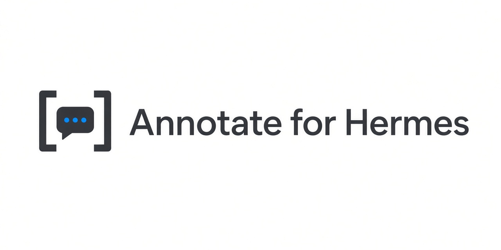
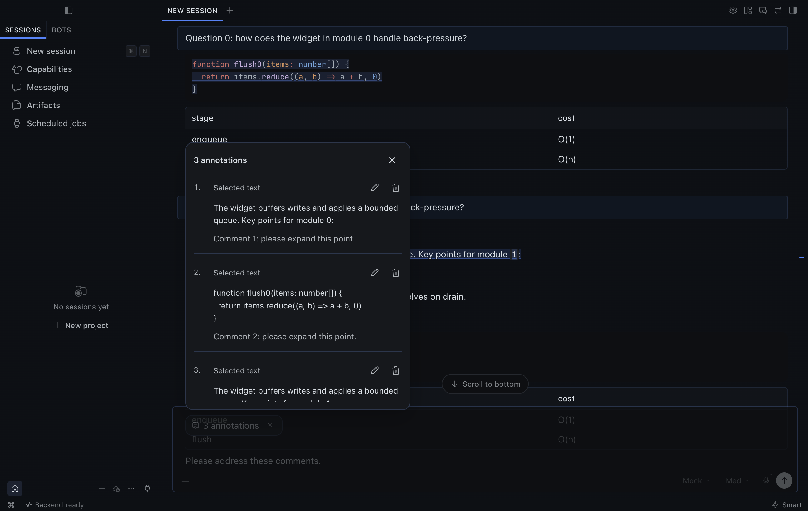

# Annotate for Hermes



Point to the exact passages you want changed. Send all your feedback in one reply.

Select text in an assistant response, choose **Add to chat**, and add an optional comment. Repeat wherever you need changes. Your selections and comments collect in one annotation attachment, ready to send with your next message.

**Works on stock Hermes.** On a stock desktop (tested on v0.23.2) the plugin runs in plain-text mode: your selections and comments collect in one readable quoted block at the top of your draft. When the desktop ships the native annotation API ([core proposal #146959](https://github.com/NousResearch/hermes-agent/pull/146959)), the same plugin switches to a single annotation chip automatically. [Catalog PR](https://github.com/NousResearch/hermes-agent/pull/146960)



Actual Hermes desktop capture with synthetic demo text; cropped to exclude account and workspace details.

## How it works

- **Select and comment.** A compact bar opens beside the passage. Type a comment, dictate one through Hermes, or leave it blank.
- **Review in place.** Numbered markers connect feedback to the text. Hover or focus the attachment to preview your selections; edit or remove comments before sending.
- **Send together.** One attachment keeps each passage paired with its comment. Adding an annotation never sends a message automatically.

The interface uses Hermes theme colors and typography. It supports up to 100 annotations per run, subject to text-size and model-context limits.

## Install

Install an exact commit of this repository:

```sh
hermes plugins install https://github.com/LarryLemonBot/annotate-for-hermes --ref FULL_COMMIT_SHA --enable
```

In **Capabilities → Plugins → Annotate for Hermes**, enable the **Desktop** switch. If Hermes is already open, run **Reload desktop plugins** from the command palette. Select assistant text and choose **Add to chat**.

The CLI flag enables the separate agent component; the Desktop switch enables this interface. No npm setup is needed to use the plugin.

### Plain-text mode (stock Hermes)

Stock Hermes has no annotation chip yet, so the plugin uses only public pieces: the browser's own text selection and the composer draft API (`host.composer.getDraft` / `setDraft`). It does not patch the app or query its markup. The block it writes looks like this:

```text
Comments on your reply (2):

**1.**
> First selected passage

Your comment

**2.**
> Second selected passage

(no comment)

(end of comments)
```

Numbered markers, review, edit and remove work as in native mode while the block is unchanged. If you edit the block by hand, it becomes ordinary draft text and the next comment starts a new block. Reference syntax such as `@file:` inside quoted text is broken with an invisible word joiner, so a quote can never attach a file. Differences from native mode: any selected text outside an input can be annotated (stock Hermes cannot tell the plugin which element is an assistant reply), the block is plain text rather than a chip, and plugin dictation needs the native dictation API.

### Native mode (patched or future Hermes)

To try the chip interface now, build a separate Hermes v0.23.0 checkout with the [native integration patch](integration/README.md). The plugin feature-detects `host.composer.annotations` version 1 and prefers it.

## Developer notes

Plain JavaScript, no runtime dependencies. The plugin uses composer SDK methods and does not make model requests, start background processes, or call external services. In native mode selection capture belongs to Hermes; in plain-text mode the plugin reads only the browser selection. Neither mode reaches into private transcript markup. Dictation uses Hermes and its configured speech-to-text provider. Only the transcript enters the annotation.

```sh
npm --prefix tests ci
npm --prefix tests test
hermes plugins validate .
```

The current candidate passes 74 plugin tests (10 cover plain-text mode). A separate Hermes v0.23.0 checkout with the included patch passed 229 focused native tests, a production build, and packaging. Earlier packaged macOS checks exercised real Grok responses, saved drafts, editing, previews, and microphone transcription. The latest packaged macOS checks passed annotation review and keyboard focus recovery in a split pane, using an existing profile with the candidate plugin loaded manually. See [behavior and testing](docs/BEHAVIOR-AND-TESTING.md) for the scope of each check.

Windows, Linux, screen readers, touch input, and the official updater path remain unverified. Native updates can replace the local SDK patch until it ships upstream. Saved attachment content persists through normal draft storage; unsaved comments and source markers do not survive an app reload. Model context limits still apply.

[Stable release checklist](docs/RELEASE-CHECKLIST.md) · [Proposed SDK and developer build](integration/README.md)

## License

MIT. The native integration contains Hermes source context under its MIT license; see [HERMES-LICENSE](integration/HERMES-LICENSE).
