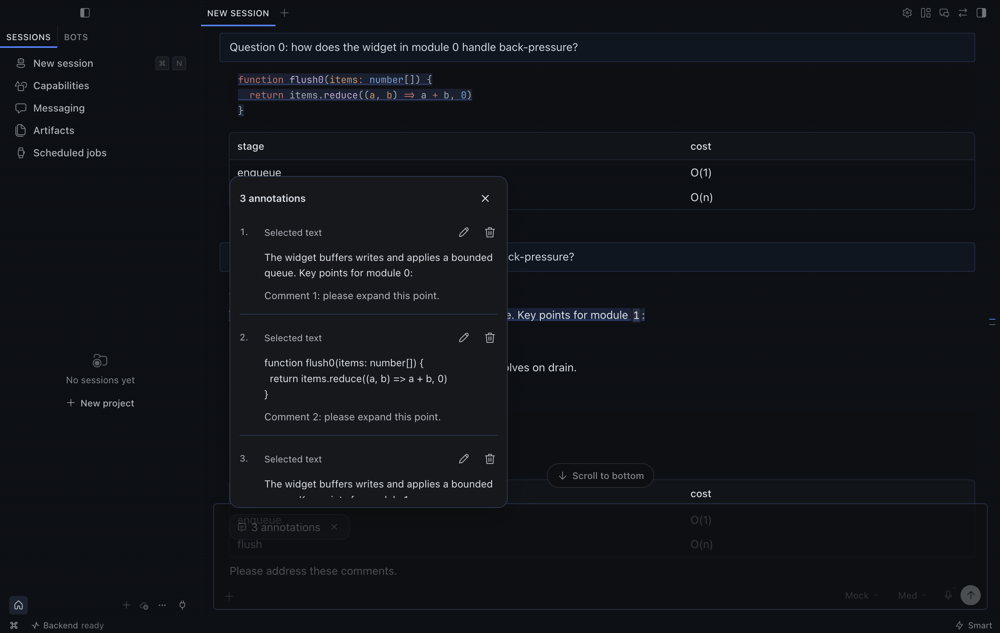

# Annotate for Hermes

Give feedback on several parts of an assistant response in one message.

Select a passage, choose **Add to chat**, and add a comment. Repeat across earlier responses. Your selections collect in one **N annotations** attachment inside the main composer. Open the attachment to review, edit, or remove individual comments, then send it with your ordinary reply.

## Availability

**Development preview. This is not yet a one-click plugin for unmodified Hermes.** The attachment UI requires the proposed `host.composer.annotations` API, including `captureSelection()`. The native extension is included under `integration/` for developers and upstream review.

Installing the plugin alone in stock Hermes will show a compatibility notice. It will not modify Hermes to make itself work. It is not currently in the curated plugin catalog.

The native integration is proposed in [Hermes PR #146959](https://github.com/NousResearch/hermes-agent/pull/146959).

The goal is a normal in-app install after the native API is available and the plugin passes catalog review. Do not describe this preview as available through Hermes' catalog.

## Interaction

- One selection action: **Add to chat**.
- Enter stages a comment; Shift+Enter inserts a line break. Staging never sends a message.
- Multiple selections and comments stay paired in one attachment.
- The ordinary reply keeps its contents and whitespace.
- Selected text and comments retain their full contents, including code indentation.
- Comments remain editable when a draft write fails. Unfinished comments stay in memory for their original connection, profile, and chat while the plugin remains loaded.
- A compact preview uses the current Hermes theme, short motion, and the operating system's reduced-motion preference.
- Normal copy commands, model selection, tools, and other plugins are not changed.

## Developer setup

The tested Hermes source base is `5057eaa3a4d0cbef0e30078418a5115faa62889e`. Use a separate checkout and a disposable Hermes home. Do not apply the extension over unrelated work.

1. Build a compatible Hermes desktop with the native extension in `integration/`.
2. Install this repository using Hermes' plugin installer, pinning an exact commit:

   ```sh
   hermes plugins install https://github.com/LarryLemonBot/annotate-for-hermes --ref FULL_COMMIT_SHA --enable
   ```

3. In **Capabilities → Plugins**, open **Annotate for Hermes** and enable its **Desktop** switch. The CLI `--enable` flag controls the separate agent component.
4. Use **Reload desktop plugins** in the command palette if the app was already open.
5. Select assistant text and choose **Add to chat**. An existing draft should stay intact.

The plugin is plain JavaScript with no runtime dependencies, Python hooks, model requests, external network calls, or background processes. All composer reads and writes use the public SDK. Selection eligibility belongs to the native API so the plugin does not depend on private transcript markup.

## Verification

```sh
npm install
npm test
hermes plugins validate .
```

`tests/native.mjs` verifies an isolated development renderer through Hermes' own performance-test connection. Set `HERMES_SOURCE_DIR`, `HERMES_TEST_HOME`, `HERMES_TEST_CDP_PORT`, and `HERMES_TEST_DEV_PORT`. The script refuses a desktop whose plugin root differs from the disposable test home. It checks three distinct passages, a single native composer chip, exact comments, edit/remove, draft preservation, reduced motion, and zero automatic submissions.

The screenshot below uses synthetic fixture messages, not personal chats.



Detailed native results are local artifacts, excluded from Git. The native run uses synthetic assistant messages and does not call a language model. Screen-reader behavior, touch input, and other operating systems require additional testing.

## Update behavior and limits

Hermes owns plugin installation and updates. This plugin does not update itself or rewrite application files. A native desktop update can replace a locally built extension until upstream includes the API; compatibility is detected at activation.

The native attachment contract allows up to 100 items, 64,000 characters per selection or comment, and 512,000 characters in the encoded attachment. Over-limit additions fail visibly and keep the comment available to edit. The model's context limit can be smaller.

Draft attachments are self-contained and survive ordinary Hermes draft persistence. Unsaved popover comments and source highlights are temporary and do not survive an app reload. Source highlights are not reconstructed from saved messages. Hermes remains responsible for sending, queuing, and restoring failed sends.

## License

MIT. The proposed native integration includes Hermes source context under its MIT license; see `integration/HERMES-LICENSE`.
